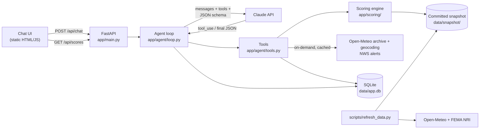

# Architecture: Weather Risk Intelligence Agent

## 1. What this is
An agent that helps logistics analysts decide **which distribution hubs are most exposed to weather disruption, and why**.

The core design principle: **the LLM never produces a number.** A deterministic, config-driven scoring model computes every score. The LLM (Claude) decides which tools to call, then explains the results in a schema-validated JSON answer. A guardrail then checks the LLM's reported numbers against the model.

## 2. System architecture



### Components and how they talk

| Component | Responsibility | Talks to |
|---|---|---|
| **Chat UI** (`app/static/`) | Chat, risk leaderboard, and collapsible evidence: drivers, assumptions, caveats, sources, tool trace, raw JSON | API over HTTP/JSON |
| **API** (`app/main.py`) | `POST /api/chat`, `POST /api/chat/stream` (SSE), `GET /api/scores`, `GET /api/hubs/{id}`, `GET /api/methodology`, `GET /health`. Optional access token and per-IP rate limit for a public URL | Agent, scoring engine |
| **Agent loop** (`app/agent/loop.py`) | Manual Claude tool-use loop (at most 8 steps). Final answer constrained by `output_config.format` (JSON schema), re-validated with Pydantic, numbers checked by a guardrail. Conversation history kept per `session_id` | Claude API, Tools, SQLite |
| **Tools** (`app/agent/tools.py`) | 7 strict-schema tools: `list_hubs`, `rank_hubs`, `get_hub_risk`, `compare_hubs`, `weather_stat`, `get_active_alerts`, `get_methodology`. Hub ids are enums, so the model cannot invent a hub | Scoring engine, external APIs, SQLite cache |
| **Scoring engine** (`app/scoring/`) | Pure functions: raw daily weather → disruption-day KPIs → hazard scores → overall score, with a full contribution breakdown. All thresholds and weights live in `weights.yaml` | Snapshot |
| **Data clients** (`app/data/`) | Open-Meteo (ERA5 history, geocoding), FEMA NRI (ArcGIS REST), NWS alerts. Retry and backoff on rate limits | Public APIs |
| **Refresh script** (`scripts/refresh_data.py`) | Rebuilds the committed snapshot from the public APIs | Public APIs, snapshot |

### Request flow (one chat turn)
1. The UI sends `{message, session_id}` to `POST /api/chat`.
2. The agent loads the session history from SQLite, appends the question, and calls Claude with the tools and the answer schema.
3. Claude calls tools, for example `get_hub_risk(dallas)`. Our code runs them deterministically and returns JSON tool results. This repeats until Claude has enough evidence.
4. Claude returns the final answer as JSON matching `AgentAnswer` (enforced by the API's structured outputs).
5. Our code validates it with Pydantic. The guardrail re-checks each `(hub, score)` the answer mentions against the scoring model and corrects any mismatch, recording a `validation_warning`.
6. The history is saved (append-only), the turn is logged to `chat_log`, and the response goes back with the tool trace, latency and model.

## 3. The KPI: Weather Disruption Risk Score
It is defined entirely in [`app/scoring/weights.yaml`](../app/scoring/weights.yaml), so analysts can tune it without code changes and every snapshot records its `weights_version`.

**Step 1: observed disruption days per year.** These come from Open-Meteo ERA5 daily data for the last 5 full years (2021–2025):

| KPI | Threshold | Why |
|---|---|---|
| Snow days | ≥ 1 cm snowfall | Yard and road operations disrupted |
| Hard-freeze days | low ≤ −12 °C (10 °F) | Equipment, de-icing, worker safety |
| Heavy-rain days | ≥ 25 mm (1 in) | Local flooding, slow trucking |
| High-wind days | gusts ≥ 65 km/h (40 mph) | High-profile vehicle restrictions |
| Extreme-heat days | high ≥ 38 °C (100 °F) | Heat-safety work restrictions |

These are scaled **absolutely**: 0 days scores 0, and a saturation level (for example 60 heat days a year) scores 100. A hub's score therefore doesn't change when hubs are added to or removed from the network.

**Step 2: FEMA National Risk Index (county level).** We use the **Expected Annual Loss *Rate* national percentile**, not the headline Risk score. The Risk score scales with a county's population and building value, so every big city looks "very high" on everything. A hub is one facility, so loss per dollar exposed is the right measure of how harsh a hazard is there. For example, Dallas County scores 99 for winter weather on the Risk score but 27 on the loss-rate percentile.

**Step 3: five hazard scores (0–100).**

| Hazard | Formula |
|---|---|
| Winter | 50% FEMA mean(winter weather, ice storm) + 25% snow days + 25% hard-freeze days |
| Hurricane | 100% FEMA hurricane |
| Flood | 60% FEMA max(inland, coastal flood) + 40% heavy-rain days |
| Severe storm | 70% FEMA mean(tornado, hail) + 30% high-wind days |
| Extreme heat | 40% FEMA heat wave + 60% extreme-heat days |

**Design rule for the weights:** where 5 years of observations sample a hazard well (snow, freeze, heat and heavy rain recur every year), observed data gets real weight. For rare events (hurricanes, tornadoes) FEMA's long-record data dominates. We reached this rule by checking the first version's results. Generic wind days made Boston look more hurricane-exposed than Miami, and FEMA's low heat *loss rate* in Phoenix (a city built for heat) hid its 100+ days a year at or above 100 °F.

**Step 4: overall score** = 25% heat + 25% flood + 20% severe storm + 15% hurricane + 15% winter (weights v1.1). The weights favor **life-threatening** hazards and follow the order of the US National Weather Service's long-term weather-fatality statistics: heat and flood are the deadliest, then tornadoes, then hurricanes (days of warning allow evacuation), then winter. Winter stays in because it disrupts operations, even though it is less often lethal on site. v1.0 weighted winter at 25%; the change moved Dallas from #6 to #3 and Phoenix from #12 to #4.
- Hazard tiers: Low <25, Moderate <50, High <75, Very High ≥75.
- The overall score has its own tiers (Very High ≥45, High ≥35, Moderate ≥25). It averages five hazards and no place has all of them, so its range is compressed.
- Every hub also reports its `top_hazard`, because resilience investments are hazard-specific (flood barriers vs. snow equipment).

## 4. Repository structure

```
app/
  main.py               FastAPI app: API routes + serves the UI
  config.py             settings (env vars, paths, climatology window)
  agent/
    loop.py             Claude tool-use loop, structured output, guardrail
    tools.py            tool implementations + strict JSON schemas
    schemas.py          Pydantic AgentAnswer / ChatResponse (the LLM <-> code contract)
    prompts.py          system prompt
  scoring/
    weights.yaml        THE KPI definition (thresholds, saturation levels, weights, tiers)
    metrics.py          daily weather -> disruption-day counts
    scoring.py          hazard + overall scores, ranking (pure functions)
  data/
    hubs.py             hub registry helpers
    open_meteo.py       ERA5 history + geocoding client
    fema_nri.py         FEMA National Risk Index client
    nws.py              NWS active alerts client
    snapshot.py         read/write the committed data snapshot
  storage/db.py         SQLite: sessions, chat log, API cache, score snapshots
  static/               index.html, app.js, styles.css (no build step)
data/
  hubs.json             the 22 hubs (id, city, coords, county FIPS, Census region)
  snapshot/             committed inputs: nri.json, weather/<hub>.json, meta.json
scripts/refresh_data.py rebuild the snapshot from public APIs
evals/                  cases.yaml + run_evals.py (agent evaluation)
tests/                  pytest unit tests for the scoring logic (offline)
docs/                   this document
Dockerfile, render.yaml deployment
```

## 5. Data storage choice

| Data | Where | Why |
|---|---|---|
| Scoring inputs (5 yr × 22 hubs of daily weather, FEMA NRI) | **JSON files committed to git** (`data/snapshot/`, about 1.5 MB) | Reproducible scores; changes are reviewable in diffs; the demo doesn't depend on free-API uptime or rate limits (Open-Meteo did rate-limit us while we built the snapshot); survives ephemeral container disks |
| Sessions, chat log, API cache, score snapshots | **SQLite** (`data/app.db`) | Zero-ops single file and plenty for one instance. Score snapshots allow diffing over time (the basis for "risk changed" alerts). The chat log gives an audit trail of every question, answer and tool call |
| KPI definition | **YAML** (`weights.yaml`) | Business-editable, versioned, reviewed like code |

**What we'd change at scale:**
- Postgres for sessions, logs and score history.
- Redis for the API cache and session state.
- A data-lake table (Parquet) for weather history if hubs grow into the hundreds.
- A scheduled job (cron or a worker queue) instead of a manual refresh script.

## 6. Scalability: what this design is, and isn't
This is a **demo-grade, single-process** design, chosen on purpose for a 1-day build:
- **Static HTML UI served by FastAPI:** no build step and one deployable. It doesn't scale as a product UI (no component model, no streaming, no auth). Next step: a React/Next.js front-end on a CDN.
- **SQLite + in-process state:** works on one instance only, and Render's free-tier disk is ephemeral, so sessions reset on redeploy. That's fine for a demo because the scoring inputs are committed to git. Next step: Postgres and Redis, then stateless API replicas behind a load balancer.
- **Synchronous agent call:** a chat request (streamed over SSE) holds one worker thread for 5–30 s. Next steps: an async Claude client and a queue for heavy jobs.
- **Rate limiting:** a naive in-memory per-IP limit. Next step: limits at the API gateway.
- **Cost and latency:** each question makes 2–5 Claude calls; see the measurements below.

### Measured performance (13-case eval set)

| Model and effort | Pass rate | Eval wall time | Typical question | Price (in/out per 1M tokens) |
|---|---|---|---|---|
| Opus 5.5, `medium` | 13/13 | 193 s | 10–22 s | $4 / $20 |
| Opus 5.5, `low` | 13/13 | 141–146 s | 5–15 s | $4 / $20 |
| Sonnet 5.5, `low`, before prompt fix | 13/13 | 132 s | 3–21 s | $2 / $10 |
| **Sonnet 5.5, `low` (default)** | **13/13** | **113 s** | **3–15 s** | **$2 / $10** |

**Why Sonnet:** with the evals as the quality bar, the stronger model bought nothing measurable, and Sonnet is faster and half the price. Its individual calls are faster too: ~1.5–2 s to pick a tool and ~5–6 s for the final answer, against ~2–3 s and ~8–10 s on Opus.

**The prompt fix:** on its first run, Sonnet made redundant tool calls. In one case it called the identical `rank_hubs` four times; in another it made 8 tool rounds, including live alerts nobody asked for. Telling it to make fewer calls doesn't work, because Sonnet 5.5 follows tool-limiting language literally and can then skip tools it needs. Two changes fixed it:
- **Factual prompt guidance:** tool results are deterministic, and the prompt states what each tool already returns (e.g. `get_hub_risk` includes the hub's rank for every hazard).
- **A duplicate-call guard in the loop:** an identical call in the same turn isn't re-run; the model is told it already has the result.

The step cap was also lowered from 8 to 5 tool rounds as a safety net. Miami-vs-Houston went from 8 tool rounds (21 s) to 1 (7 s).

- **Prompt caching (the API's KV cache) is on and working.** Tools, the system prompt and the history form a stable prefix, and >99% of input tokens are read from cache. One measured follow-up turn: 6 uncached input tokens and 14,238 tokens read from cache.
- **Where the time goes (investigated on Opus 5.5):** a tool-selecting Claude call takes ~2–3 s. The final answer call takes ~8–10 s, but we measured that **~8 s of that passes before the API sends its first byte** (`message_start`). After that, the answer text arrives in under a second. We isolated the cause by testing the same call without the refusal fallback, without the JSON schema, and with thinking summaries: none of them changed the time to first byte. So it's model-side time (hidden reasoning plus latency variance), not something our code adds.
- **Streaming (`POST /api/chat/stream`, Server-Sent Events):** the UI shows live progress ("Thinking…", "✓ get_hub_risk(dallas)", "Reviewing tool results…") within ~2 s, then the answer text as soon as it exists. The `answer` field is decoded incrementally from the partial JSON (`AnswerFieldStreamer`, unit-tested); the full validated response follows in a final event. Streaming improves *perceived* latency. It can't shorten the model's time to first byte; a faster model tier would, and that's a quality/latency trade-off to settle with the eval set.
- **Deliberately not used:**
  - RAG or a vector DB: the data is structured numbers that tools return exactly, so retrieval would only add a way to be wrong.
  - Multi-agent setups or fine-tuning: unnecessary for this scope.
  - Answer caching: possible per data version, but follow-ups depend on the conversation, so the hit rate would be low.

## 7. Assumptions, uncertainty and scope
**Scope.** 22 fixed US hubs; 5 hazard families; historical exposure, not forecasting. Live NWS alerts are shown for context but never change the score. The agent declines non-US, forecasting and financial-loss questions.

**Assumptions.**
- A hub's location is the city center coordinate, and its FEMA data is its county's.
- "Midwest" etc. follow US Census regions.
- "Last year" means the last full calendar year (2025).
- A "snow day" for percentage questions means ≥ 0.1 cm, which filters out reanalysis trace noise; for scoring it means ≥ 1 cm.

**Uncertainty the analyst should know about.**
- ERA5 is a ~25 km gridded reanalysis, not a station record. Snowfall and peak gusts are smoothed, so counts can differ from airport observations.
- Five years is a short window: it under-samples rare events, which is why FEMA carries that weight.
- FEMA NRI is county-level, and a large county (Harris, Los Angeles) mixes very different micro-locations.
- The weights and thresholds are expert judgment, not fitted to outcomes. **The obvious next step is calibration:** backtest scores against the company's own hub closure and delay history, then fit the weights.
- Scores are exposure indices, not probabilities or dollar losses.

## 8. LLM contract and guardrails
- **Strict tool schemas:** `strict: true`, with hub ids, hazards, regions and metrics as enums, so the model can't call tools with invented arguments.
- **Structured final answer:** `output_config.format` enforces the `AgentAnswer` JSON schema at generation time, and Pydantic re-validates it, retrying once on failure.
- **Numeric guardrail:** every `(hub_id, score_type, score)` in the answer is compared with the deterministic model; mismatches are corrected and flagged.
- **Failure handling:** a tool error is returned to the model as `is_error`, so it can recover or explain. API errors become a structured "couldn't answer" response, and a broken turn is never saved into history.
- **Refusals:** server-side fallback (`fallbacks: "default"`) is enabled, and a `refusal` stop reason is handled explicitly.

## 9. Evaluation
- `pytest tests/`: offline unit tests for the KPI logic. They check that weights sum to 1, the tier thresholds, the snow-day math, freeze-threshold edges, annualization, saturation, monotonicity, that contributions add up, and that a hub's score is independent of the rest of the network.
- `python -m evals.run_evals`: 13 agent cases covering the four sample questions, a follow-up conversation, methodology, a non-hub city, out-of-scope questions, an unknown hub and a false-premise question. **Grading is deterministic:** expected rankings and numbers are computed from the scoring code at run time, with no LLM judge. Results are written to `evals/results/`.
